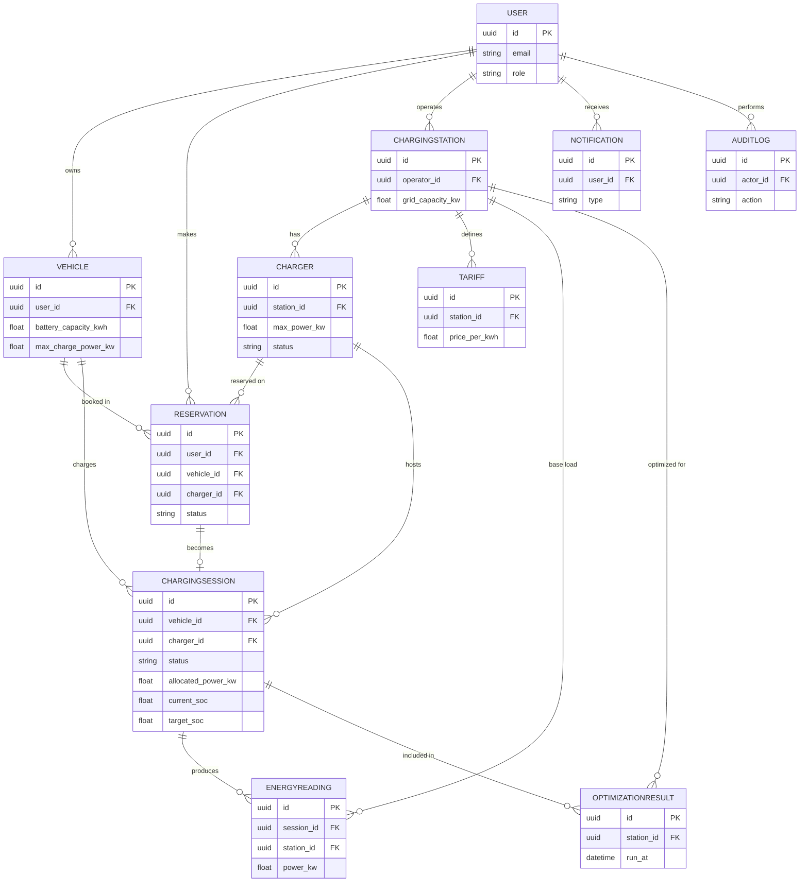
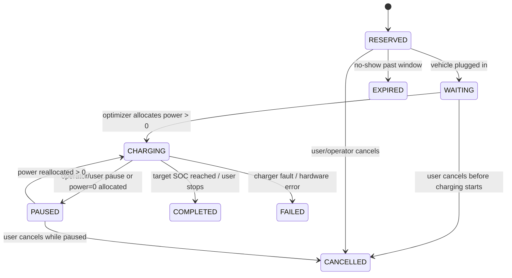

   # EV Charging Load Optimization Platform — Master Architecture & Roadmap

## 1. Project Overview

You are building a backend-heavy platform where multiple EVs share a limited pool of
electrical power at a charging station, and the system continuously decides **who gets
how much power, right now**, so the station never exceeds its grid capacity while still
charging EVs fairly and cost-effectively.

This is not a booking app with a charging session bolted on — the core deliverable is
the **optimization engine** (rule-based → greedy → LP) plus the real-time infrastructure
(Channels/WebSockets, Celery/Redis) that feeds it live data and pushes decisions back out.

## 2. Real-World Problem

Charging stations are provisioned with a fixed grid connection (e.g. 100 kW), but as EV
adoption grows, simultaneous demand routinely exceeds that limit (110 kW demand vs 100 kW
supply in your example). Naive first-come-first-served charging either trips breakers,
forces the utility to curtail service, or wastes money by over-provisioning grid capacity
that sits idle most of the day. Smart/dynamic load management — allocating power based on
urgency, SOC, deadlines, and price — is an active real industry problem (OCPP smart
charging profiles, V2G, demand-response programs), which is exactly why this makes a
strong final-year project: it's a real constrained-optimization problem, not synthetic
busywork.

## 3. Functional Requirements

- Auth: registration/login (JWT), role-based access (EV_USER, STATION_OPERATOR, ADMIN)
- Vehicle management: EV_USER can register vehicles (battery capacity, max charge rate)
- Station/charger management: operators create stations, define chargers and capacity
- Reservations: EV_USER books a charger/time slot
- Charging session lifecycle: start, pause, resume, stop, complete, cancel, fail
- Live load monitoring: per-station real-time load, per-charger allocated power
- Optimization engine: recompute allocation whenever load/demand changes
- Energy readings: periodic kWh/power samples per session and per station
- Dynamic tariffs: time-of-use pricing feeding into cost calc and optimizer
- Notifications: session events, deadline warnings, peak-load alerts
- Analytics: consumption, utilization, peak load, optimization performance (before/after)
- Audit log: who did what, when (esp. operator/admin actions)
- Charger simulator: synthetic EV arrivals/departures/SOC changes for development/demo

## 4. Non-Functional Requirements

| Category | Requirement |
|---|---|
| Performance | Optimization recompute for a station (≤50 chargers) in <500ms |
| Scalability | Horizontally scalable Django + Celery workers; stateless API |
| Reliability | Station never allocates more than its declared capacity (hard invariant) |
| Real-time | Dashboard load updates delivered via WebSocket within ~1s of a change |
| Security | JWT auth, RBAC, input validation, rate limiting, audit trail |
| Observability | Structured logs, error tracking, basic metrics/health checks |
| Testability | Optimization core is pure/deterministic and unit-testable in isolation |
| Portability | Fully dockerized, reproducible via `docker compose up` |

## 5. User Roles

Already well-specified in your prompt — summarized:

- **EV_USER**: owns vehicles, reservations, sessions; read-only on stations/chargers
- **STATION_OPERATOR**: owns stations they created; full CRUD on their chargers/tariffs; read on sessions at their stations
- **ADMIN**: superset — manages users, all stations, system config, audit logs

Enforce with DRF permission classes + object-level checks (operators can only touch stations where `station.operator == request.user`).

## 6. System Architecture

```text
                     ┌──────────────────────┐
                     │        Nginx          │
                     └──────────┬────────────┘
                    ┌────────────┴────────────┐
                    ▼                           ▼
            ┌───────────────┐           ┌───────────────┐
            │  React (SPA)   │           │  Django ASGI   │
            │  Tailwind      │           │  (Channels)    │
            └───────┬────────┘           └───────┬────────┘
                    │  REST + WebSocket           │
                    └──────────────┬───────────────┘
                                   ▼
                     ┌──────────────────────────┐
                     │   Django + DRF (API)      │
                     │   apps: accounts, vehicles│
                     │   stations, charging,     │
                     │   reservations,           │
                     │   optimization, energy,   │
                     │   tariffs, notifications, │
                     │   analytics, audit        │
                     └─────────┬─────────┬───────┘
                               │         │
                 ┌─────────────┘         └─────────────┐
                 ▼                                       ▼
        ┌────────────────┐                      ┌────────────────┐
        │  PostgreSQL     │                      │     Redis       │
        │  (system of      │◄────────────────────┤ (Channels layer,│
        │   record)        │                      │  Celery broker,│
        └────────────────┘                      │  cache)         │
                                                  └───────┬────────┘
                                                          ▼
                                                 ┌────────────────┐
                                                 │ Celery Workers  │
                                                 │ + Celery Beat   │
                                                 │ (optimization,  │
                                                 │  notifications, │
                                                 │  reports,       │
                                                 │  simulator tick)│
                                                 └────────────────┘
```

**Data flow for a single optimization cycle:**

```text
Charger simulator (or real charger) reports SOC/power
        ↓
EnergyReading written to Postgres
        ↓
Signal / Celery task: "station load changed"
        ↓
Optimization engine recalculates allocation for that station
        ↓
OptimizationResult saved + ChargingSession.allocated_power updated
        ↓
Result pushed to Redis channel layer group "station_<id>"
        ↓
Django Channels consumer broadcasts to all connected WebSocket clients
        ↓
React dashboard updates live (no polling)
```

## 7. Database Design & ER Diagram

Core entities (fields trimmed to what matters — expand types/constraints as you build):

**User** (custom model, `AbstractUser`): `id (UUID, PK)`, `email (unique)`, `role (enum: EV_USER/STATION_OPERATOR/ADMIN)`, `phone`, `is_active`, `created_at`

**Vehicle**: `id PK`, `user_id FK→User`, `make`, `model`, `battery_capacity_kwh`, `max_charge_power_kw`, `created_at`

**ChargingStation**: `id PK`, `operator_id FK→User`, `name`, `address`, `latitude`, `longitude`, `grid_capacity_kw`, `is_active`

**Charger**: `id PK`, `station_id FK→ChargingStation`, `identifier`, `max_power_kw`, `status (enum: AVAILABLE/OCCUPIED/OFFLINE/FAULT)`, `connector_type`

**Reservation**: `id PK`, `user_id FK→User`, `vehicle_id FK→Vehicle`, `charger_id FK→Charger`, `start_time`, `end_time`, `status (enum: PENDING/CONFIRMED/CANCELLED/EXPIRED)`, `unique_together(charger, overlapping time)` enforced at app level (exclusion constraint via `django.contrib.postgres` `ExclusionConstraint` is the "correct" Postgres-native way — worth learning)

**ChargingSession**: `id PK`, `reservation_id FK nullable`, `vehicle_id FK`, `charger_id FK`, `user_id FK`, `status (state machine — see §9)`, `start_soc`, `target_soc`, `current_soc`, `allocated_power_kw`, `energy_delivered_kwh`, `started_at`, `completed_at`, `estimated_completion_at`

**EnergyReading**: `id PK`, `session_id FK nullable`, `station_id FK`, `charger_id FK nullable`, `timestamp`, `power_kw`, `cumulative_energy_kwh`, `reading_type (SESSION/STATION_BASE)` — indexed on `(station_id, timestamp)` for time-series queries

**Tariff**: `id PK`, `station_id FK`, `name`, `price_per_kwh`, `time_start`, `time_end`, `tariff_type (OFF_PEAK/NORMAL/PEAK)`

**OptimizationResult**: `id PK`, `station_id FK`, `run_at`, `algorithm_version`, `input_snapshot (JSONField)`, `output_allocations (JSONField)`, `total_allocated_kw`, `objective_value nullable`

**Notification**: `id PK`, `user_id FK`, `type`, `title`, `body`, `is_read`, `created_at`

**AuditLog**: `id PK`, `actor_id FK`, `action`, `target_type`, `target_id`, `metadata (JSONField)`, `created_at`



## 8. Django App Architecture — Should Each Be a Separate App?

| App | Separate app? | Why |
|---|---|---|
| `accounts` | Yes | Custom user model must live in its own app from day one (Django requirement/best practice) |
| `vehicles` | Yes | Clean ownership boundary, independent lifecycle from stations |
| `stations` | Yes | Station + Charger models; operator-owned domain |
| `reservations` | Yes | Distinct lifecycle/state machine from sessions; keeps `charging` app focused |
| `charging` | Yes | ChargingSession + state machine — the busiest app, keep it lean by not merging with reservations |
| `optimization` | Yes | Isolated, pure-logic-heavy app; you want this importable/testable with zero Django request-cycle coupling |
| `energy` | Yes | EnergyReading + load calculation utilities; read by both charging and analytics |
| `tariffs` | Yes | Small but independent domain (pricing rules operators configure) |
| `notifications` | Yes | Generic, reusable, triggered by many other apps via signals/Celery |
| `analytics` | Yes | Read-mostly aggregation layer over other apps' data |
| `audit` | Yes | Cross-cutting, written to by everything via a signal/middleware |
| `simulator` | Yes (add this one) | Keep synthetic-data generation fully separate so it can be deleted/disabled without touching real logic |

Rule of thumb you should articulate in your report: split by **bounded context / who changes it and why**, not by "how many models it has." A 3-model app that changes for a completely different reason than its neighbor still deserves its own app.

## 9. Charging Session State Machine



- **Who triggers what**: EV_USER triggers RESERVED→WAITING (plug in), WAITING/CHARGING→CANCELLED. The **optimizer** (system) triggers CHARGING↔PAUSED transitions based on allocated power. Operators/admins can force FAILED or CANCELLED. Only the system marks COMPLETED (SOC target reached) or the user (manual stop).
- **Validation**: reject any transition not in the table above (enforce in a `transition(new_state)` method on the model, not scattered `if` checks in views).
- **DB representation**: `status` as a Django `TextChoices`, plus a `ChargingSessionEvent` log table (optional but recommended) recording every transition with timestamp + actor for audit/debugging.

## 10. Load Monitoring

```text
Current Station Load = Base Load (non-EV) + Σ(allocated_power_kw of active sessions)
Available Capacity   = grid_capacity_kw − Current Station Load
```

- Readings originate from the **charger simulator** in dev (and would come from OCPP `MeterValues` messages from real hardware in production).
- Store every reading in `EnergyReading` (append-only, time-series). Don't overwrite — recompute "current load" as an aggregate query over the latest reading per active session, cached in Redis for fast dashboard reads.
- Frequency: every 10–30s is realistic for a demo; production OCPP stations typically report every 30–300s.
- Historical: keep raw readings for a rolling window (e.g. 30 days) and roll up to hourly/daily aggregates for analytics beyond that.
- Abnormal readings (negative power, power exceeding charger max, sudden jump): flag and exclude from optimizer input, log to `AuditLog`, don't silently trust hardware.

## 11. Optimization Engine (the core of the project)

### Stage 1 — Rule-Based Priority

```text
SOC_Deficit        = target_soc - current_soc                     (0–100)
Departure_Urgency  = 1 / max(minutes_until_departure, 1)          (higher = more urgent)
Required_Energy_kWh= battery_capacity_kwh * (SOC_Deficit / 100)

Priority Score = w1 * SOC_Deficit + w2 * Departure_Urgency + w3 * Required_Energy_kWh
```

Normalize each term to 0–1 before weighting (min-max scale across the active session set)
so `w1+w2+w3` stays interpretable. Start with `w1=0.4, w2=0.4, w3=0.2` and tune later —
document *why* you chose these, since examiners will ask.

### Stage 2 — Greedy Allocation

```text
1. Sort active sessions by Priority Score, descending
2. remaining = station.available_capacity_kw
3. for session in sorted_sessions:
       want = min(session.vehicle.max_charge_power_kw, session.charger.max_power_kw)
       give = min(want, remaining)
       allocate(session, give)
       remaining -= give
4. If remaining > 0 after one pass, do a second pass giving proportional
   "extra" to sessions still below their max (handles fairness a bit).
```

This alone already satisfies your worked example (110 kW demand → capped at 100 kW,
higher-priority EVs get their full ask first).

### Stage 3 — Mathematical Optimization (LP)

- **Decision variables**: `p_i` = power (kW) allocated to session *i* this cycle
- **Objective** (minimize):
  `Σ cost_i(p_i) + λ_peak * peak_load + λ_dissat * Σ dissatisfaction_i(p_i) + λ_deadline * Σ deadline_violation_i`
- **Constraints**:
  - `Σ p_i ≤ station.grid_capacity_kw`
  - `0 ≤ p_i ≤ min(vehicle.max_charge_power_kw, charger.max_power_kw)` for every session
  - `Σ (p_i * time_remaining_i) ≥ required_energy_i` where deadline is hard
- **Library**: `PuLP` (simplest to learn, CBC solver bundled) or `scipy.optimize.linprog` for a pure-Python path with no external solver binary. Recommend PuLP for readability in a student project.
- Run this as a Celery task (not inline in the request/response cycle) since an LP solve for dozens of variables can take noticeably longer than a greedy pass.

Write pseudocode for all three stages before touching PuLP syntax — this is exactly the
kind of section where I should walk you through it interactively rather than hand you a
finished solver, per your teaching-style request in §29 of your brief.

## 12. Real-Time Architecture (Channels)

- One Channels **group per station**: `station_<id>`
- On connect: authenticate the WebSocket via JWT (validate token from query param or first message; Channels doesn't get normal header auth for free), then `channel_layer.group_add("station_<id>", channel_name)` — but only if the user is authorized for that station (owner/operator/admin, or an EV_USER with an active session there).
- On optimization result / load change: Celery task or Django signal calls `channel_layer.group_send` with the new allocation payload.
- Reconnection: client-side exponential backoff; on reconnect, first fetch REST snapshot (`GET /api/stations/{id}/load`) then resubscribe to WS, so the UI is never stale between disconnect and reconnect.
- Failure handling: if Redis is down, Channels degrades — design the frontend to fall back to polling `GET /api/stations/{id}/load` every N seconds if the WS connection fails to establish after retries.

## 13. Celery Architecture

Run asynchronously (never inline in a request):

- Optimization engine execution (triggered by signal, debounced — don't re-run on every single reading, batch/coalesce within e.g. a 2–5s window)
- Email/push notifications
- Peak-load alert detection
- Daily/weekly energy + revenue reports (Celery Beat schedule)
- Charger simulator "tick" (Celery Beat, e.g. every 10s, generates synthetic readings)
- Reservation expiry sweep (Beat, marks no-shows as EXPIRED)

**Never use a synchronous request for**: anything involving a solver call, anything sending external notifications, anything that loops over many rows for a report. If a view's handler would block for >~100ms doing non-DB-index work, it belongs in Celery.

## 14. Charger Simulator

- A separate `simulator` app with a Celery Beat task ticking every N seconds.
- Maintains simple synthetic vehicle state machines in DB (or Redis) that emit realistic events: arrival → initial SOC → charging → SOC ramps up proportional to allocated power → random early-departure or fault events for realism.
- Talks to Django the same way real hardware would: it writes `EnergyReading` rows and calls the same "station load changed" hook a real OCPP integration would call — this is the key design point: **the simulator should not have a special code path**; it exercises the exact same ingestion API/service layer that real chargers would use, so swapping in real hardware later is a config change, not a rewrite.

## 15–24. Remaining Sections (Frontend, Testing, Security, Docker, MVP/Advanced split, Checklist, Schedule, Demo, Interview Qs)

These sections are large and are exactly where the "teach me step by step, don't dump
everything" instruction in your own brief (§29) matters most — dashboards, the full test
suite, the full security checklist, and Docker Compose files are things we should build
together as we hit each phase, so the code stays understandable rather than pasted.

Below is the **planning-level** version of each (roadmap, checklist, schedule) — the part
that's genuinely useful to have in full up front. We'll flesh out the *implementation* of
each (actual test files, actual Dockerfiles, actual React components) phase by phase.

### MVP (must exist for the project to "work")
Auth + roles · Vehicle CRUD · Station/Charger CRUD · Reservations · Charging session state
machine · Charger simulator · Load monitoring · Rule-based + Greedy optimizer · Basic
REST API for all of the above · Minimal React dashboard (no WS yet, polling is fine)

### Version 2 (upgrades the MVP)
LP-based optimizer · Django Channels real-time updates · Dynamic tariffs feeding the
optimizer · Notifications via Celery · Analytics module with before/after comparison ·
Audit logs

### Advanced / Research (make it exceptional)
Multi-station load balancing · V2G-style discharge simulation · Fairness-aware
optimization variants · Load forecasting to pre-position allocations · Performance/scale
testing at 500–1000 simulated EVs

### Explicitly do NOT build
Real payment gateway (mock a `PaymentRecord` instead) · Real OCPP hardware integration
(simulator only, but design the ingestion layer so it *could* accept OCPP later) · ML
before the LP optimizer is solid · Microservices (a modular monolith with clean Django
apps is the correct scope) · Blockchain/"AI-everything" features that don't serve the
core problem.

### Critical Path (what blocks what)

```text
Custom User + JWT auth
      ↓
Vehicle model  →  Station + Charger models
      ↓                    ↓
      └────────► Reservation
                       ↓
              ChargingSession + state machine
                       ↓
              EnergyReading + Load calculation  ←── Charger Simulator (needed in parallel)
                       ↓
          ┌── Rule-based optimizer
          ├── Greedy optimizer
          └── LP optimizer
                       ↓
          Celery (to run optimizer async) + Redis
                       ↓
          Django Channels (to push results live)
                       ↓
          React dashboards consuming REST + WS
                       ↓
          Analytics (needs historical session/energy data to exist first)
                       ↓
          Notifications, Audit, Tariffs (can be built in parallel once core exists)
                       ↓
          Testing (continuous, but load testing needs the full pipeline)
                       ↓
          Docker → Deployment
```

**Everything downstream of the optimizer is blocked on ChargingSession + EnergyReading
existing.** That's your true critical path — get auth → vehicles/stations → reservations
→ sessions → simulator → load calc solid before writing a single line of optimizer code.

### Detailed Implementation Checklist (by milestone)

**Milestone 0 — Foundations**
- [ ] Requirements doc finalized, this architecture reviewed
- [ ] Git repo created, `main`/`develop` branches, branch protection
- [ ] Django project scaffolded (`config/` + `apps/` layout)
- [ ] Postgres running (docker-compose for dev), `DATABASES` configured
- [ ] `.env` + `django-environ` or similar, secrets never committed

**Milestone 1 — Identity**
- [ ] Custom `User` model (`accounts` app) with `role` field
- [ ] JWT auth (`djangorestframework-simplejwt`): register, login, refresh, logout/blacklist
- [ ] Role-based permission classes (`IsEVUser`, `IsStationOperator`, `IsAdmin`)
- [ ] Postman collection: register/login/refresh happy-path + 401/403 cases

**Milestone 2 — Domain Core**
- [ ] `Vehicle` model + CRUD API (owner-only)
- [ ] `ChargingStation` model + CRUD API (operator-only writes, public reads)
- [ ] `Charger` model + CRUD API, nested under station
- [ ] Object-level permission tests (EV_USER blocked from station-operator endpoints)

**Milestone 3 — Booking & Sessions**
- [ ] `Reservation` model + API + overlap validation
- [ ] `ChargingSession` model + state machine (`transition()` method + tests)
- [ ] Session lifecycle API: start, pause, stop, cancel
- [ ] Unit tests for every valid/invalid transition

**Milestone 4 — Load & Simulation**
- [ ] `EnergyReading` model + ingestion service function (not tied to any one caller)
- [ ] Load calculation utility (`current_load`, `available_capacity`)
- [ ] `simulator` app + Celery Beat tick generating synthetic readings
- [ ] Dashboard-ready `GET /api/stations/{id}/load` endpoint

**Milestone 5 — Optimization**
- [ ] Rule-based priority function + unit tests (pure function, no DB)
- [ ] Greedy allocator + unit tests incl. your 110kW/100kW worked example as a test case
- [ ] Celery task wiring: reading change → debounced optimizer run
- [ ] `OptimizationResult` persisted per run
- [ ] LP model (PuLP) as an alternate strategy behind a feature flag/version field

**Milestone 6 — Real-Time**
- [ ] Django Channels installed, ASGI routing configured
- [ ] JWT-authenticated WebSocket consumer, per-station groups
- [ ] Optimizer → `group_send` wiring
- [ ] Frontend WS client with reconnect + REST fallback

**Milestone 7 — Money & Notifications**
- [ ] `Tariff` model + CRUD, time-of-use resolution helper
- [ ] Cost calculation on session completion
- [ ] `Notification` model + Celery tasks for each event type
- [ ] Peak-load alert task (Beat, threshold-based)

**Milestone 8 — Analytics & Audit**
- [ ] Aggregation queries: utilization, avg session time/cost, peak load
- [ ] Before/after optimization comparison report
- [ ] `AuditLog` writes on all state-changing operator/admin actions
- [ ] Admin analytics API + dashboard views

**Milestone 9 — Frontend**
- [ ] EV_USER dashboard (session status, SOC, cost, ETA)
- [ ] Operator dashboard (live load, chargers, optimization status)
- [ ] Admin dashboard (system-wide metrics)

**Milestone 10 — Hardening**
- [ ] Full security checklist pass (see your brief §19)
- [ ] Rate limiting on auth + write endpoints
- [ ] Integration tests for full reservation→session→completion flow
- [ ] Load test: 100 → 500 → 1000 simulated concurrent EVs, record optimizer latency

**Milestone 11 — Ship**
- [ ] Dockerfiles (backend, frontend), `docker-compose.yml` (all services from §21)
- [ ] Nginx reverse proxy config, static/media handling
- [ ] CI (GitHub Actions): lint, test, build on PR
- [ ] Deploy to a cloud VM/PaaS, HTTPS via Let's Encrypt or platform-managed certs
- [ ] Final report, ER/architecture diagrams exported, demo script rehearsed

### Suggested 12–16 Week Schedule

| Weeks | Focus |
|---|---|
| 1–2 | Milestone 0–1 (foundations, auth) |
| 3–4 | Milestone 2 (vehicles, stations, chargers) |
| 5–6 | Milestone 3 (reservations, session state machine) |
| 7 | Milestone 4 (load monitoring + simulator) |
| 8–9 | Milestone 5 (optimization engine — the heaviest week block, budget extra time) |
| 10 | Milestone 6 (Channels real-time) |
| 11 | Milestone 7 (tariffs, notifications) |
| 12 | Milestone 8 (analytics, audit) |
| 13 | Milestone 9 (frontend dashboards) |
| 14 | Milestone 10 (security + testing + load testing) |
| 15 | Milestone 11 (Docker, CI/CD, deploy) |
| 16 | Buffer: report writing, demo rehearsal, polish |

### Demo Scenario (for your presentation)

1. Show the operator dashboard with 4 chargers idle, station capacity 100 kW.
2. Trigger the simulator to bring 4 EVs online with demand 30/25/30/25 kW (110 kW total).
3. Show the dashboard live-update via WebSocket: total demand 110 kW flagged, optimizer
   allocates ≤100 kW, higher-priority EVs get closer to their requested power.
4. Pause/fault one charger live — show reallocation happen automatically.
5. Let one session reach target SOC → show it transition to COMPLETED and free up
   capacity, which the optimizer immediately redistributes to the remaining EVs.
6. Switch to the analytics view: show the peak-load-before-vs-after chart from your own
   logged `OptimizationResult` history.

### Likely Interview Questions

- Why greedy before LP? What does greedy get wrong that LP fixes?
- How do you guarantee the sum of allocations never exceeds grid capacity under
  concurrent writes (race conditions)?
- Why Celery for the optimizer instead of running it in the request cycle?
- How does a WebSocket client authenticate, and what happens if the token expires
  mid-connection?
- How would you swap the simulator for real OCPP hardware — what in your design would
  need to change vs. what stays the same?
- How did you validate the state machine is actually enforced（and not bypassable via a
  raw PATCH）?
- What's your strategy if two optimization runs overlap for the same station?

---

**Where to go from here**: per your own instruction in §29, the right next step is *not*
more planning — it's picking Milestone 1 (Identity) and building it with me interactively:
model → migration → serializer → view → permission → Postman test, explaining each piece
as we go, before moving to Milestone 2. Say the word and we'll start there.
